# Diagram Aliran Data (Data Flow Diagram / DFD) — ADuri 🌿

Dokumen ini memodelkan arsitektur aliran data, proses, penyimpanan data (*data store*), entitas eksternal, dan batas kepercayaan (*trust boundary*) pada aplikasi web **ADuri**.

---

## 1. Notasi & Batas Kepercayaan (Trust Boundaries)

Sistem ADuri beroperasi melintasi **3 (tiga) Trust Boundary utama**:
1. **TB1: Client-Server Trust Boundary (Batas Kepercayaan Klien–Server)**  
   Memisahkan peramban pengguna (*untrusted client environment*) yang rentan terhadap manipulasi sisi klien, inspeksi memori, atau ekstensi jahat, dengan server backend Next.js (*trusted runtime environment*).
2. **TB2: Application-Storage & Secrets Trust Boundary (Batas Kepercayaan Aplikasi–Penyimpanan & Rahasia)**  
   Memisahkan logika pemrosesan aplikasi Next.js dengan tempat penyimpanan persisten (database) serta variabel lingkungan rahasia (`.env.local`). Komunikasi melintasi batas ini wajib menggunakan sanitasi query dan enkripsi data sensitif.
3. **TB3: Internal-External Service Trust Boundary (Batas Kepercayaan Aplikasi Internal–Pihak Ketiga)**  
   Memisahkan sistem internal ADuri dengan layanan eksternal di luar kendali langsung aplikasi (Layanan WhatsApp Web/API, Google Maps, dan Kanal Perbankan/QRIS).

---

## 2. Diagram DFD Level 1 (Mermaid Diagram)

```mermaid
flowchart TB
    %% ==========================================================
    %% STYLING DEFINITIONS
    %% ==========================================================
    classDef entity fill:#26321f,stroke:#1a2315,stroke-width:2px,color:#ffffff,font-weight:bold;
    classDef process fill:#31572c,stroke:#203b1d,stroke-width:2px,color:#ffffff,font-weight:bold;
    classDef cryptoProcess fill:#1e4620,stroke:#eab308,stroke-width:3px,color:#ffffff,font-weight:bold;
    classDef store fill:#fef3c7,stroke:#d97706,stroke-width:2px,color:#78350f,font-weight:bold;
    classDef cryptoStore fill:#dcfce7,stroke:#16a34a,stroke-width:3px,color:#14532d,font-weight:bold;
    classDef boundary fill:none,stroke:#dc2626,stroke-width:2px,stroke-dasharray: 6 6,color:#dc2626,font-weight:bold;

    %% ==========================================================
    %% TRUST BOUNDARY 1: CLIENT (UNTRUSTED BROWSER)
    %% ==========================================================
    subgraph TB1_CLIENT ["TB1: Untrusted Client / Browser Zone"]
        E1["[E1] Calon Pembeli / Pengguna Web"]:::entity
    end

    %% ==========================================================
    %% APPLICATION RUNTIME (NEXT.JS SERVER-SIDE ZONE)
    %% ==========================================================
    subgraph TB1_SERVER ["Trusted Application Server Zone (Next.js Node.js Runtime)"]
        P1["[P1] Penjelajahan Katalog & Detail Durian<br/>(app/produk, app/produk/slug)"]:::process
        P2["[P2] Validasi & Perhitungan Form Pemesanan<br/>(app/pembayaran/page.tsx)"]:::process
        P3["[P3] 🔐 Komponen Kriptografi & Proteksi Data<br/>(lib/crypto.ts: AES, HMAC)"]:::cryptoProcess
        P4["[P4] Penjadwalan Booking Kunjungan Kebun<br/>(app/ambil-sendiri/page.tsx)"]:::process
        P5["[P5] 🔐 Penanganan Autentikasi & Hash Password<br/>(lib/crypto.ts: bcrypt)"]:::cryptoProcess
    end

    %% ==========================================================
    %% TRUST BOUNDARY 2: PERSISTENCE & SECRETS ZONE
    %% ==========================================================
    subgraph TB2_STORAGE ["TB2: Secure Storage & Secrets Zone"]
        DS1[("[(DS1)] Mock Data Produk<br/>(data/products.ts)")]:::store
        DS2[("[(DS2)] 🔐 Basis Data Akun Pengguna<br/>(users: password_hash [bcrypt])")]:::cryptoStore
        DS3[("[(DS3)] 🔐 Basis Data Pesanan<br/>(orders: phone_enc, address_enc, hmac)")]:::cryptoStore
        DS4[("[(DS4)] 🔐 Basis Data Booking Kebun<br/>(bookings: phone_enc, deposit)")]:::cryptoStore
        DS5[("[(DS5)] 🔐 Environment Secrets<br/>(.env.local: ENCRYPTION_KEY, HMAC_SECRET)")]:::cryptoStore
    end

    %% ==========================================================
    %% TRUST BOUNDARY 3: EXTERNAL THIRD-PARTY SERVICES
    %% ==========================================================
    subgraph TB3_EXTERNAL ["TB3: External Third-Party Services Zone"]
        E2["[E2] Pemilik Kebun / Admin<br/>(WhatsApp: 6281234567890)"]:::entity
        E3["[E3] Gateway Bank BCA / Mandiri & QRIS"]:::entity
        E4["[E4] Layanan Google Maps<br/>(maps.app.goo.gl)"]:::entity
    end

    %% ==========================================================
    %% DATA FLOWS
    %% ==========================================================
    %% Flow Katalog
    E1 -- "[DF01] Request halaman katalog/produk" --> P1
    P1 -- "[DF02] Query detail produk durian" --> DS1
    DS1 -- "[DF03] Data varietas & harga durian" --> P1
    P1 -- "[DF04] Render responsif spesifikasi & katalog" --> E1

    %% Flow Pemesanan
    E1 -- "[DF05] Input Nama, No HP, Alamat, Qty, Metode Bayar" --> P2
    P2 -- "[DF06] Payload pesanan tervalidasi" --> P3
    DS5 -- "[DF07] Baca ENCRYPTION_KEY & HMAC_SECRET 🔐" --> P3
    P3 -- "[DF08] Simpan PII terenkripsi AES & Signature HMAC 🔐" --> DS3
    P3 -- "[DF09] Tampilkan ringkasan pesanan & total bayar" --> E1
    E1 -. "[DF10] Bukti bayar transfer manual / QRIS" .-> E3

    %% Flow Ambil Sendiri
    E1 -- "[DF11] Input Booking (Nama, No HP, Jadwal, Deposit Rp50rb)" --> P4
    P4 -- "[DF12] Simpan jadwal kunjungan & status deposit 🔐" --> DS4
    P4 -- "[DF13] Buka tautan rute peta kebun" --> E4
    P4 -- "[DF14] Deep-link konfirmasi WhatsApp dengan ringkasan booking" --> E2

    %% Flow Autentikasi Pengguna
    E1 -- "[DF15] Kredensial Registrasi/Login (Password Plaintext)" --> P5
    P5 -- "[DF16] Simpan/Verifikasi Hash Password bcrypt 🔐" --> DS2
```

---

## 3. Katalog Elemen DFD & Penandaan Aset Kriptografi

### A. Entitas Eksternal (External Entities)
| ID Elemen | Nama Entitas | Zona Trust Boundary | Deskripsi |
|:---:|:---|:---|:---|
| **E1** | Calon Pembeli / Pengguna Web | TB1 (Untrusted Client) | Pengguna akhir yang mengakses web melalui browser desktop, tablet, atau smartphone. |
| **E2** | Pemilik Kebun / Admin | TB3 (External Services) | Pengelola kebun keluarga Asynur yang menerima konfirmasi pesanan dan jadwal booking via WhatsApp. |
| **E3** | Sistem Bank / QRIS | TB3 (External Services) | Institusi perbankan (BCA/Mandiri) atau aggregator QRIS untuk settlement pembayaran transfer/QR. |
| **E4** | Layanan Google Maps | TB3 (External Services) | Penyedia peta rute eksternal untuk penunjuk arah ke lokasi kebun di Kampar, Riau. |

### B. Proses (Processes)
| ID Elemen | Nama Proses | Zona Trust Boundary | Melibatkan Kriptografi? | Deskripsi Fungsi |
|:---:|:---|:---|:---:|:---|
| **P1** | Penjelajahan Katalog Durian | Trusted Server Zone | Tidak | Menampilkan daftar produk durian, harga, dan indikator rasa (manis, pahit, legit). |
| **P2** | Validasi & Perhitungan Pesanan | Trusted Server Zone | Tidak | Melakukan sanitasi & client-side validation (regex HP, panjang alamat) serta hitung subtotal. |
| **P3** | Pemrosesan Kriptografi & Proteksi Pesanan | Trusted Server Zone | **YA (AES + HMAC)** | Mengenkripsi nomor HP & alamat dengan **AES-256-GCM** serta menandatangani payload dengan **HMAC-SHA256**. |
| **P4** | Penjadwalan Booking Kunjungan Kebun | Trusted Server Zone | **YA (AES No HP)** | Memproses data jadwal kedatangan, mengenkripsi kontak, dan menyusun link konfirmasi WA. |
| **P5** | Penanganan Autentikasi & Hash Password | Trusted Server Zone | **YA (bcrypt)** | Memproses pendaftaran dan login akun dengan membangkitkan hash **bcrypt** (cost factor 12). |

### C. Penyimpanan Data (Data Stores)
| ID Elemen | Nama Data Store | Zona Trust Boundary | Perlindungan Kriptografi | Aset Terkait |
|:---:|:---|:---|:---:|:---|
| **DS1** | Mock Data Produk (`data/products.ts`) | TB2 (Storage Zone) | Tidak (Data Publik) | AST-08 (Katalog Durian) |
| **DS2** | Basis Data Akun (`users` table) | TB2 (Storage Zone) | **YA — Hashing bcrypt** | AST-01 (Password Hash) |
| **DS3** | Basis Data Pesanan (`orders` table) | TB2 (Storage Zone) | **YA — AES-256-GCM + HMAC-SHA256** | AST-03 (HP), AST-04 (Alamat), AST-05 (Payload HMAC) |
| **DS4** | Basis Data Booking (`bookings` table) | TB2 (Storage Zone) | **YA — AES-256-GCM** | AST-03 (HP), AST-06 (Data Booking) |
| **DS5** | File Environment (`.env.local`) | TB2 (Storage Zone) | **YA — Kunci Master Kriptografi** | AST-02 (Encryption Key & Secret) |

### D. Aliran Data (Data Flows)
| ID Aliran | Sumber | Tujuan | Data yang Mengalir | Aset Terkait | Dilindungi Kriptografi? |
|:---:|:---|:---|:---|:---:|:---:|
| **DF01** | E1 | P1 | HTTP GET Request rute `/produk` & `/produk/[slug]` | AST-08 | HTTPS / TLS |
| **DF02** | P1 | DS1 | Query data produk durian berdasarkan slug | AST-08 | Tidak (In-Memory) |
| **DF03** | DS1 | P1 | Data objek varietas durian (nama, deskripsi, harga) | AST-08 | Tidak (In-Memory) |
| **DF04** | P1 | E1 | Render HTML/CSS katalog produk dan galeri foto | AST-08 | HTTPS / TLS |
| **DF05** | E1 | P2 | Form submit data pembeli, kuantitas, dan metode bayar | AST-03, AST-04, AST-05 | HTTPS / TLS |
| **DF06** | P2 | P3 | Payload pesanan tervalidasi | AST-03, AST-04, AST-05 | In-Memory (Node.js) |
| **DF07** | DS5 | P3 | `ENCRYPTION_KEY` (32 char) & `HMAC_SECRET` | AST-02 | **YA (Kunci Kriptografi)** |
| **DF08** | P3 | DS3 | `phone_enc`, `address_enc`, `order_signature` (Hex) | AST-03, AST-04, AST-05 | **YA (AES-256-GCM & HMAC)** |
| **DF09** | P3 | E1 | Ringkasan pesanan & instruksi transfer/QRIS | AST-05, AST-07 | HTTPS / TLS |
| **DF10** | E1 | E3 | Eksekusi transfer manual ke BCA / scan QRIS | AST-07 | Jalur Bank / HTTPS |
| **DF11** | E1 | P4 | Form submit booking kebun, tanggal, jam, rombongan | AST-03, AST-06 | HTTPS / TLS |
| **DF12** | P4 | DS4 | Jadwal kunjungan, `phone_enc`, status deposit | AST-03, AST-06 | **YA (AES-256-GCM)** |
| **DF13** | P4 | E4 | Tautan navigasi Google Maps (`maps.app.goo.gl`) | AST-11 | HTTPS / TLS |
| **DF14** | P4 | E2 | Payload pesan WhatsApp dengan parameter booking | AST-03, AST-06 | HTTPS / TLS (wa.me) |
| **DF15** | E1 | P5 | Form input email & password plaintext | AST-01 | HTTPS / TLS |
| **DF16** | P5 | DS2 | Simpan / verifikasi hash bcrypt (`$2b$12$...`) | AST-01 | **YA (bcrypt hash)** |

---

## 4. Validasi Pemenuhan Rubrik DFD
- [x] **Seluruh komponen produk berjalan tergambar**: Meliputi alur katalog, pemesanan online, fitur ambil sendiri / booking kebun, hingga manajemen kriptografi.
- [x] **Penyimpanan data & aliran data lengkap**: DS1 hingga DS5 dan DF01 hingga DF16 teridentifikasi dengan jelas.
- [x] **Minimal dua trust boundary**: Memiliki **3 trust boundary** (TB1: Client-Server, TB2: Application-Storage/Secrets, TB3: Internal-External Services).
- [x] **Aset data yang dilindungi kriptografi ditandai**: Elemen P3, P5, DS2, DS3, DS4, DS5, DF07, DF08, DF12, dan DF16 diberi tanda khusus (`🔐`) beserta spesifikasi algoritmanya.
