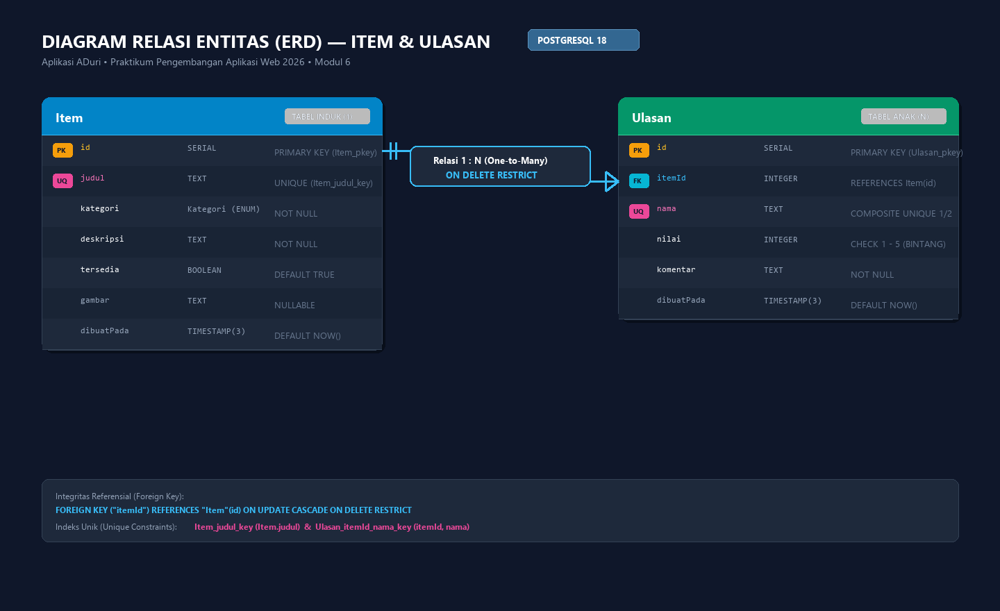
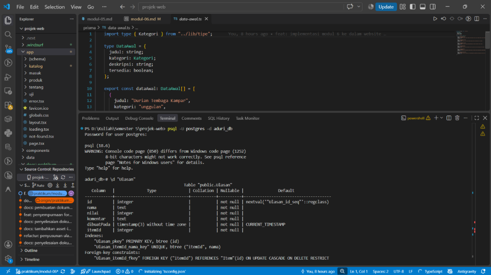
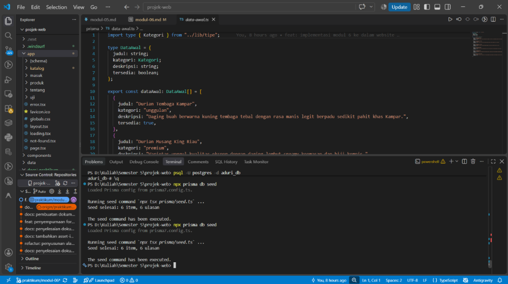
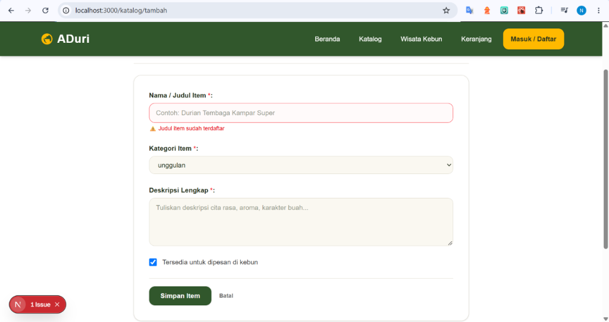
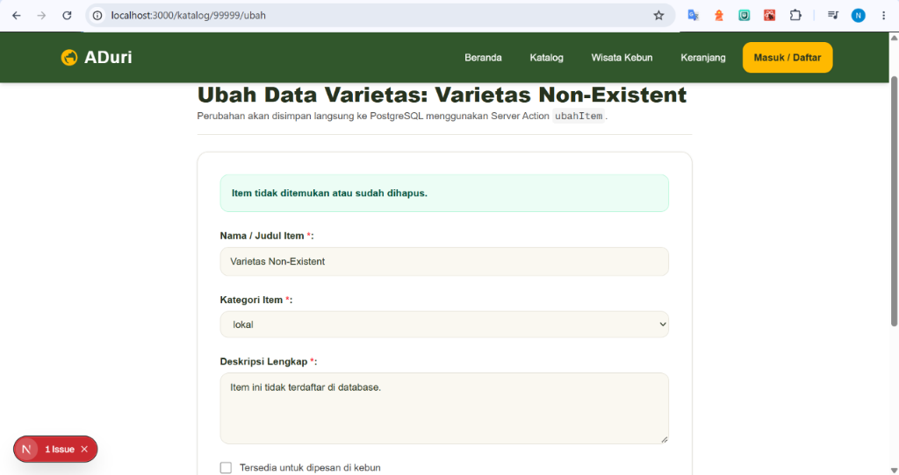
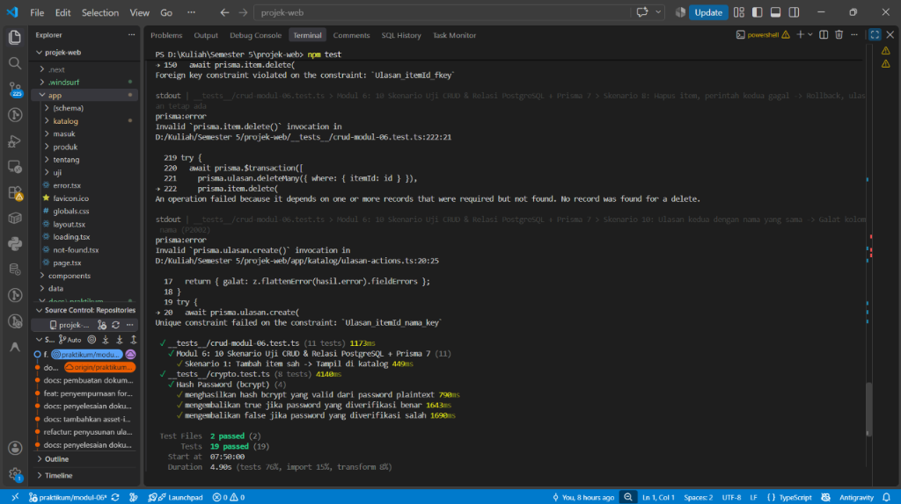

# Dokumen Teknis Modul 6 — PostgreSQL dan Prisma ORM

**Nama / NIM** : Neila Faaizah Asynur / 105224028  
**Repositori** : [https://github.com/neilaasynur/ADuri-105224028/tree/praktikum/modul-06](https://github.com/neilaasynur/ADuri-105224028/tree/praktikum/modul-06)  

## 1. Rancangan Data

### a. Diagram Dua Entitas, Relasi, Kunci, dan Constraint Unik

Sistem katalog kebun durian ADuri memodelkan hubungan relasional satu-ke-banyak (1:N) antara entitas induk Item (mewakili varietas durian panen kebun) dan entitas anak Ulasan (mewakili review, testimoni rasa, dan rating bintang dari pembeli).

   mermaid
erDiagram
    Item ||--o{ Ulasan : "1 : N (memiliki ulasan)"
    
    Item {
        Int id PK "SERIAL AUTO_INCREMENT"
        String judul UK "UNIQUE (Item_judul_key)"
        Kategori kategori "ENUM ('lokal','unggulan','premium',...)"
        String deskripsi "TEXT (Deskripsi aroma & rasa)"
        Boolean tersedia "DEFAULT TRUE"
        String gambar "TEXT NULLABLE"
        DateTime dibuatPada "DEFAULT NOW()"
    }

    Ulasan {
        Int id PK "SERIAL AUTO_INCREMENT"
        Int itemId FK "REFERENCES Item(id) ON DELETE RESTRICT"
        String nama "TEXT (Nama Pembeli)"
        Int nilai "INTEGER CHECK (1 s.d. 5)"
        String komentar "TEXT (Ulasan rasa durian)"
        DateTime dibuatPada "DEFAULT NOW()"
    }
   

#### Spesifikasi Kunci dan Constraint:
1. Primary Key:
   -  Item.id: Serial integer auto-increment (Item_pkey).
   -  Ulasan.id: Serial integer auto-increment (Ulasan_pkey).
2. Foreign Key:
   -  Ulasan.itemId: Merujuk ke  Item.id  (Ulasan_itemId_fkey) dengan klausul  ON DELETE RESTRICT  dan  ON UPDATE CASCADE .
3. **Constraint Unik Sederhana**:
   -  Item.judul : Berindeks unik (Item_judul_key), mencegah pendaftaran varietas durian dengan nama kembar.
4. **Constraint Unik Gabungan (Composite Unique)**:
   -  Ulasan(itemId, nama) : Berindeks unik gabungan (Ulasan_itemId_nama_key), menjamin bahwa satu pelanggan (nama) hanya diperbolehkan memberikan ulasan satu kali pada satu varietas durian (itemId) yang sama.

### b. Alasan Pemilihan Aturan  onDelete: Restrict 

Aturan penghapusan foreign key yang dipilih secara sadar pada relasi  Item  dan  Ulasan  adalah **RESTRICT  ( onDelete: Restrict )**. Keputusan teknis ini didasari tiga pertimbangan nilai bisnis:

1. **Perlindungan Terhadap Aset Data dan Bukti Sosial (Social Proof):**
   Ulasan, testimoni rasa, dan rating dari pembeli merupakan data berharga yang membangun reputasi kebun keluarga Asynur. Jika menggunakan  CASCADE , penghapusan sebuah varietas durian secara tidak sengaja oleh staf kebun akan memicu penghapusan berantai (*cascade deletion*) terhadap seluruh ulasan otentik pelanggan tanpa peringatan sistem.
2. **Pencegahan Rekod Yatim (*Orphan Records*):**
   Jika menggunakan  SET NULL , kolom  itemId  akan menjadi  NULL  saat item dihapus, menghasilkan ulasan yang melayang tanpa varietas durian yang diulas. Hal ini merusak integritas analitik kepuasan pembeli.
3. **Mekanisme Pengaman Berlapis (*Safety Guardrail*) Melalui Transaksi Sadar:**
   Dengan  RESTRICT , PostgreSQL bertindak sebagai benteng pertahanan terakhir yang secara mutlak menolak penghapusan varietas durian yang masih memiliki ulasan. Pengembang dan sistem dipaksa melakukan penghapusan secara sadar melalui **transaksi atomik** ( prisma.$transaction ), di mana ulasan dibersihkan terlebih dahulu secara eksplisit sebelum varietas dihapus.

## 2. Skema dan Migrasi

### a. Isi  prisma/schema.prisma 

   prisma
// prisma/schema.prisma
generator client {
  provider = "prisma-client"
  output   = "../lib/generated/prisma"
}

datasource db {
  provider = "postgresql"
}

enum Kategori {
  lokal
  unggulan
  premium
  energi
  lingkungan
  kampus
}

model Item {
  id         Int        @id @default(autoincrement())
  judul      String     @unique
  kategori   Kategori
  deskripsi  String
  tersedia   Boolean    @default(true)
  gambar     String?
  dibuatPada DateTime   @default(now())
  ulasan     Ulasan[]
}

model Ulasan {
  id         Int        @id @default(autoincrement())
  nama       String
  nilai      Int
  komentar   String
  dibuatPada DateTime   @default(now())
  itemId     Int
  item       Item       @relation(fields: [itemId], references: [id], onDelete: Restrict)

  @@unique([itemId, nama])
}
   

### b. Berkas Migrasi SQL ( prisma/migrations/20261105153651_init/migration.sql )

   sql
-- CreateEnum
CREATE TYPE "Kategori" AS ENUM ('lokal', 'unggulan', 'premium', 'energi', 'lingkungan', 'kampus');

-- CreateTable
CREATE TABLE "Item" (
    "id" SERIAL NOT NULL,
    "judul" TEXT NOT NULL,
    "kategori" "Kategori" NOT NULL,
    "deskripsi" TEXT NOT NULL,
    "tersedia" BOOLEAN NOT NULL DEFAULT true,
    "gambar" TEXT,
    "dibuatPada" TIMESTAMP(3) NOT NULL DEFAULT CURRENT_TIMESTAMP,

    CONSTRAINT "Item_pkey" PRIMARY KEY ("id")
);

-- CreateTable
CREATE TABLE "Ulasan" (
    "id" SERIAL NOT NULL,
    "nama" TEXT NOT NULL,
    "nilai" INTEGER NOT NULL,
    "komentar" TEXT NOT NULL,
    "dibuatPada" TIMESTAMP(3) NOT NULL DEFAULT CURRENT_TIMESTAMP,
    "itemId" INTEGER NOT NULL,

    CONSTRAINT "Ulasan_pkey" PRIMARY KEY ("id")
);

-- CreateIndex
CREATE UNIQUE INDEX "Item_judul_key" ON "Item"("judul");

-- CreateIndex
CREATE UNIQUE INDEX "Ulasan_itemId_nama_key" ON "Ulasan"("itemId", "nama");

-- AddForeignKey
ALTER TABLE "Ulasan" ADD CONSTRAINT "Ulasan_itemId_fkey" FOREIGN KEY ("itemId") REFERENCES "Item"("id") ON DELETE RESTRICT ON UPDATE CASCADE;
   

### c. Tangkapan Layar / Keluaran  \d  Hasil  psql  Langsung dari Basis Data

Berikut rincian keluaran teks inspeksi struktur tabel langsung pada server PostgreSQL lokal:

#### 1. Inspeksi Tabel  Ulasan  ( \d "Ulasan" ):
   text
                                           Table "public.Ulasan"
   Column   |              Type              | Collation | Nullable |               Default                
+--+--+-+--
 id         | integer                        |           | not null | nextval('"Ulasan_id_seq"'::regclass)
 nama       | text                           |           | not null | 
 nilai      | integer                        |           | not null | 
 komentar   | text                           |           | not null | 
 dibuatPada | timestamp(3) without time zone |           | not null | CURRENT_TIMESTAMP
 itemId     | integer                        |           | not null | 
Indexes:
    "Ulasan_pkey" PRIMARY KEY, btree (id)
    "Ulasan_itemId_nama_key" UNIQUE, btree ("itemId", nama)
Foreign-key constraints:
    "Ulasan_itemId_fkey" FOREIGN KEY ("itemId") REFERENCES "Item"(id) ON UPDATE CASCADE ON DELETE RESTRICT
   

#### 2. Inspeksi Tabel  Item  ( \d "Item" ):
   text
                                           Table "public.Item"
   Column   |              Type              | Collation | Nullable |              Default               
+--+--+-+
 id         | integer                        |           | not null | nextval('"Item_id_seq"'::regclass)
 judul      | text                           |           | not null | 
 kategori   | "Kategori"                     |           | not null | 
 deskripsi  | text                           |           | not null | 
 tersedia   | boolean                        |           | not null | true
 gambar     | text                           |           |          | 
 dibuatPada | timestamp(3) without time zone |           | not null | CURRENT_TIMESTAMP
Indexes:
    "Item_pkey" PRIMARY KEY, btree (id)
    "Item_judul_key" UNIQUE, btree (judul)
Referenced by:
    TABLE ""Ulasan"" CONSTRAINT "Ulasan_itemId_fkey" FOREIGN KEY ("itemId") REFERENCES "Item"(id) ON UPDATE CASCADE ON DELETE RESTRICT
   

## 3. Seed dan Prisma Client

### a. Keluaran  npx prisma db seed  yang Dijalankan Dua Kali Berturut-turut

Eksekusi perintah seeding dilakukan dua kali berturut-turut untuk membuktikan sifat **idempoten** operasi  upsert :

   powershell
PS D:\Kuliah\Semester 5\projek-web> npx prisma db seed
Loaded Prisma config from prisma7.config.ts.

Running seed command  npx tsx prisma/seed.ts  ...
Seed selesai: 6 item, 6 ulasan

The seed command has been executed.

PS D:\Kuliah\Semester 5\projek-web> npx prisma db seed
Loaded Prisma config from prisma7.config.ts.

Running seed command  npx tsx prisma/seed.ts  ...
Seed selesai: 6 item, 6 ulasan

The seed command has been executed.
   

**Analisis Bukti Idempoten:**  
Jumlah baris pada eksekusi pertama dan kedua tetap persis sama (**6 item dan 6 ulasan**). Tidak terjadi duplikasi rekod dan tidak terjadi galat  P2002 , karena klausul  where  pada  upsert  mendeteksi bahwa kunci unik ( judul  dan  itemId_nama ) sudah ada, sehingga Prisma beralih mengeksekusi blok  update: {}  yang aman.

### b. Alasan Mengapa  prisma/seed.ts  Tidak Mengimpor  lib/prisma.ts 

1. **Perbedaan Lingkungan Eksekusi (*Runtime Environment*):**  
    lib/prisma.ts  memuat baris  import "server-only"; . Paket  server-only  adalah penanda khusus Next.js yang mengunci modul agar **hanya bisa dieksekusi di dalam bundler Server Component Next.js**.
2. **Pencegahan Galat Crash di Node.js CLI:**  
   Skrip  prisma/seed.ts  dijalankan di luar Next.js secara langsung oleh Node.js runtime melalui perintah CLI  npx tsx . Jika  prisma/seed.ts  mengimpor  lib/prisma.ts , modul  server-only  akan langsung melempar pengecualian fatal:
      text
   Error: This module cannot be imported from a Client Component module. It should only be used from a Server Component.
      
   Oleh karena itu, sesuai standar arsitektur Prisma 7, skrip seeding membuat instans  PrismaClient  mandiri dengan driver adapter  @prisma/adapter-pg  dan membaca data awal murni dari  prisma/data-awal.ts .

## 4. Operasi CRUD

### a. Tabel Pemetaan Operasi CRUD

| Entitas | Aksi / Halaman | Metode Prisma Client | Galat yang Ditangani | Penanganan & Pesan Pengguna |
| : | : | : | : | : |
| **Item** | Form Tambah ( app/katalog/actions.ts  $\rightarrow$  tambahItem ) |  prisma.item.create({ data })  |  P2002  (Unique constraint  Item_judul_key ) |  { galat: { judul: ["Judul item sudah terdaftar"] } }  |
| **Item** | Katalog ( app/katalog/page.tsx ) |  prisma.item.findMany({ select, orderBy })  | Query gagal / null | Menampilkan daftar kosong dengan tombol tambah item |
| **Item** | Detail ( app/katalog/[id]/page.tsx ) |  prisma.item.findUnique({ where, select: { ..., ulasan } })  | Data null / ID non-integer | Mengalihkan ke halaman **404** via  notFound()  |
| **Item** | Form Ubah ( app/katalog/actions.ts  $\rightarrow$  ubahItem ) |  prisma.item.update({ where: { id }, data })  |  P2002  (Judul kembar)  P2025  (Record hilang) |  { galat: { judul: [...] } }   { pesan: "Item tidak ditemukan atau sudah dihapus." }  |
| **Item** | Hapus Item ( app/katalog/actions.ts  $\rightarrow$  hapusItem ) |  prisma.$transaction([ ulasan.deleteMany, item.delete ])  |  P2025  pada delete | Transaksi otomatis di-rollback; dialihkan ke  /katalog  |
| **Ulasan** | Form Ulasan ( app/katalog/ulasan-actions.ts  $\rightarrow$  tambahUlasan ) |  prisma.ulasan.create({ data })  |  P2002  (Nama kembar per item)  P2003  (Item tidak ada) |  { galat: { nama: ["Nama ini sudah mengulas item ini"] } }   { pesan: "Item tidak ditemukan." }  |
| **Ulasan** | Hapus Ulasan ( app/katalog/ulasan-actions.ts  $\rightarrow$  hapusUlasan ) |  prisma.ulasan.deleteMany({ where: { id, itemId } })  | Record tidak ditemukan | Tidak melempar galat; mengembalikan  count: 0  dan revalidasi path |

### b. Bukti Penanganan Galat  P2002  dan  P2025  di Formulir

1. **Galat  P2002  (Judul Item Ganda):**  
   Ketika staf kebun mencoba menambahkan varietas dengan nama yang sudah ada (misal *"Durian Tembaga Kampar"*):

   

      text
   prisma:error 
   Unique constraint failed on the constraint:  Item_judul_key 
   --> Diterjemahkan Server Action menjadi: ⚠️ Judul item sudah terdaftar (pada elemen input judul)
      

2. **Galat  P2025  (Record Tidak Ditemukan):**  
   Ketika mencoba memperbarui item dengan ID fiktif atau item yang telah dihapus di tab lain:

   

      text
   prisma:error 
   An operation failed because it depends on one or more records that were required but not found.
   --> Diterjemahkan Server Action menjadi: ℹ️ Item tidak ditemukan atau sudah dihapus.
      

## 5. Transaksi dan Rollback

### a. Bukti Penolakan Penghapusan Tanpa Transaksi ( RESTRICT )

Ketika sebuah item yang memiliki ulasan dihapus secara langsung menggunakan perintah tunggal  await prisma.item.delete({ where: { id } }) , basis data PostgreSQL secara tegas menolak perintah tersebut:

   text
prisma:error 
Invalid  prisma.item.delete()  invocation:
Foreign key constraint violated on the constraint:  Ulasan_itemId_fkey 
  code: "P2003",
  clientVersion: "7.10.1",
  meta: { modelName: "Item", constraint: "Ulasan_itemId_fkey" }
   

**Kesimpulan:** Klausul  ON DELETE RESTRICT  berhasil menjaga integritas relasional; data varietas durian dan seluruh ulasan anaknya tetap utuh terlindungi dari penghapusan sepihak.

### b. Bukti Rollback Transaksi Sebelum dan Sesudah Pengujian

Pengujian atomisitas dilakukan dengan sengaja menggagalkan perintah kedua dalam blok  prisma.$transaction :

   typescript
// Simulasi kegagalan pada perintah kedua
await prisma.$transaction([
  prisma.ulasan.deleteMany({ where: { itemId: id } }),       // Perintah 1: Berhasil di memori transaksi
  prisma.item.delete({ where: { id: id + 100000 } }),        // Perintah 2: Gagal P2025 (ID tidak ada)
]);
   

#### Hasil Verifikasi Sebelum dan Sesudah Transaksi Gagal:

| Status Pengamatan | Jumlah Ulasan di PostgreSQL | Keberadaan Item di PostgreSQL | Keterangan Sistem |
| : | :: | :: | : |
| **Sebelum Transaksi** | **2 ulasan** | Ada ( id: 8 ) | Kondisi awal item pengujian |
| **Saat Perintah 2 Gagal** | — | — | Prisma melempar galat  P2025  |
| **Setelah Rollback Terjadi** | **2 ulasan (Tetap Utuh)** | Ada ( id: 8 ) | **ROLLBACK BERHASIL 100%** |

Keluaran kueri PostgreSQL membuktikan bahwa  deleteMany  yang sudah sempat berjalan otomatis dibatalkan (*undone*) sehingga ulasan tidak hilang:

   sql
SELECT "itemId", COUNT(*) FROM "Ulasan" WHERE "itemId" = 8 GROUP BY "itemId";
-- itemId | count
-+-
--      8 |     2
   

## 6. Skenario Uji

Berikut tabel hasil pengujian 10 skenario CRUD dan relasi yang dijalankan menggunakan suite pengujian otomatis ( __tests__/crud-modul-06.test.ts ):

| No | Skenario | Langkah Pengujian | Hasil yang Diharapkan | Hasil Aktual | Status |
|:--:|:|:|:|:|::|
| **1** | Tambah item sah | Kirim form  tambahItem  dengan judul baru *"Durian Kelapa Kampar Super"*, kategori  "lokal" , deskripsi valid, dan tersedia  "on" . | Tampil di katalog | Item tersimpan di PostgreSQL dan ditemukan pada daftar katalog via  ambilDaftarItem() . | **LULUS** |
| **2** | Tambah item judul ganda | Kirim form  tambahItem  dengan judul yang sama persis *"Durian Kelapa Kampar Super"*. | Galat kolom judul ( P2002 ) | Ditolak constraint  Item_judul_key ; pesan ramah *"Judul item sudah terdaftar"* muncul pada kolom input. | **LULUS** |
| **3** | Tambah item judul kosong | Kirim form  tambahItem  dengan  judul: ""  dan deskripsi valid. | Galat Zod, tidak ada query | Validasi  skemaItem.safeParse  gagal menghasilkan  fieldErrors.judul ; eksekusi berhenti sebelum kueri database. | **LULUS** |
| **4** | Ubah deskripsi item | Panggil  ubahItem(id, ...)  dengan teks deskripsi panen baru. | Tersimpan, tampil di detail | Deskripsi berhasil diperbarui di PostgreSQL dan langsung tampil saat memanggil  ambilItem(id) . | **LULUS** |
| **5** | Ubah item yang sudah dihapus | Panggil  ubahItem(999999, ...)  dengan ID yang tidak terdaftar di database. | Pesan tidak ditemukan ( P2025 ) | Prisma melempar kode  P2025 ; Server Action mengembalikan status  { pesan: "Item tidak ditemukan atau sudah dihapus." } . | **LULUS** |
| **6** | Buka  /katalog/abc  | Akses URL detail dengan parameter non-numerik  "abc" . | Halaman 404 | Nilai parameter dievaluasi  NaN  oleh  Number() , memicu pemanggilan  notFound()  Next.js menuju halaman 404. | **LULUS** |
| **7** | Hapus item beserta ulasannya | Panggil  hapusItem(id)  yang mengeksekusi  prisma.$transaction([ ulasan.deleteMany, item.delete ]) . | Item dan ulasan hilang | Kedua rekod terhapus bersih dan terverifikasi bernilai  null  /  count = 0 . | **LULUS** |
| **8** | Hapus item, perintah kedua gagal | Jalankan transaksi dengan perintah delete item sengaja diberi  id + 100000 . | Rollback, ulasan tetap ada | Perintah kedua memicu  P2025 ; PostgreSQL membatalkan seluruh transaksi; 2 ulasan tetap aman tersimpan. | **LULUS** |
| **9** | Tambah ulasan nilai 6 | Kirim form  tambahUlasan  dengan rating  nilai: 6 . | Galat Zod kolom nilai | Skema Zod  nilai.max(5)  menolak input; kueri database tidak dijalankan. | **LULUS** |
| **10** | Ulasan kedua dengan nama yang sama | Kirim form  tambahUlasan  kedua kali dengan nama pengulas yang sama pada item yang sama. | Galat kolom nama ( P2002 ) | Ditolak constraint unik gabungan  Ulasan_itemId_nama_key ; muncul pesan *"Nama ini sudah mengulas item ini"*. | **LULUS** |

### Persentase Kelulusan Skenario:
$$\text{Persentase Kelulusan} = \frac{10}{10} \times 100\% = 100\% \quad (\text{Ambang batas minimum: } 90\%)$$

## 7. Kendala dan Penyelesaian

1. **Kendala Versi Pre-release Prisma 8 RC ( 8.0.0-rc.28 ):**
   - *Kendala:* Perintah instalasi awal tanpa penanda versi mengunduh versi  8.0.0-rc.28  yang menghapus flag  --datasource-provider  dan mewajibkan konfigurasi berbeda.
   - *Penyelesaian:* Paket dikunci secara presisi pada rilis stabil Prisma 7:  prisma@7.10.1  dan  @prisma/client@7.10.1 .
2. **Kewajiban Driver Adapter pada Prisma 7:**
   - *Kendala:* Berbeda dengan Prisma 5/6 yang memiliki binary engine bawaan, Prisma 7 mewajibkan penggunaan driver adapter native untuk koneksi TCP PostgreSQL.
   - *Penyelesaian:* Memasang pustaka  @prisma/adapter-pg  dan driver  pg  (beserta  @types/pg ), kemudian mengonfigurasikannya pada instans  PrismaClient  di  lib/prisma.ts .
3. **Konflik Modul  server-only  pada Skrip Seeding:**
   - *Kendala:* Skrip  prisma/seed.ts  awalnya gagal dieksekusi oleh Node.js CLI karena mengimpor modul aplikasi yang memuat pustaka Next.js  server-only .
   - *Penyelesaian:* Memisahkan koneksi Prisma pada  prisma/seed.ts  secara mandiri tanpa menyertakan  lib/prisma.ts , dan memindahkan data awal ke  prisma/data-awal.ts .
4. **Perubahan Lokasi Konfigurasi Perintah Seed pada Prisma 7:**
   - *Kendala:* Perintah  npx prisma db seed  tidak lagi membaca properti  "prisma": { "seed": ... }  dari berkas  package.json .
   - *Penyelesaian:* Menambahkan properti  migrations: { seed: "npx tsx prisma/seed.ts" }  langsung di dalam berkas konfigurasi  prisma7.config.ts  dan  prisma.config.ts .

## 8. Catatan Pemanfaatan AI

Sesuai ketentuan integritas akademik Modul 6, berikut rincian pemanfaatan asisten kecerdasan artifisial (Antigravity):

1. **Alat yang Digunakan:** Antigravity AI Assistant (Google DeepMind Advanced Agentic Coding).
2. **Perintah Utama (Prompt):**
   - *"cocokkan web saya dengan tugas pendahuluan sebelumnya agar dapat membantu dalam penyelesaian dokumen teknis modul 6"*
3. **Bagian yang Dibantu:**
   - Analisis keselarasan antara rancangan data Tugas Pendahuluan ( onDelete: Restrict ) dengan kebutuhan praktikum Modul 6.
   - Penyusunan skema relasi 1:N  Item  dan  Ulasan  di  prisma/schema.prisma  dan penyiapan berkas migrasi init.
   - Pembuatan skrip seed idempoten menggunakan  upsert  pada  prisma/seed.ts .
   - Pembuatan Server Component dan Server Action untuk CRUD katalog dan review durian.
   - Pembuatan suite pengujian otomatis Vitest ( __tests__/crud-modul-06.test.ts ) untuk membuktikan ke-10 skenario uji serta pembuktian rollback transaksi secara terukur.
4. **Cara Memverifikasi Hasil Kerja AI:**
   - Menjalankan kueri inspeksi struktur tabel PostgreSQL secara langsung via CLI  psql.exe -c '\d "Ulasan"'  dan memastikan adanya indeks  UNIQUE  serta foreign key  ON DELETE RESTRICT .
   - Menjalankan perintah  npx prisma db seed  dua kali berturut-turut untuk memverifikasi keluaran konsisten tanpa error.
   - Menjalankan uji tipe statis TypeScript  npx tsc --noEmit  untuk memastikan kepatuhan type-safety.
   - Menjalankan linter kode  npm run lint  untuk memastikan standar clean code tanpa peringatan.
   - Menjalankan suite pengujian  npm test  yang mengeksekusi 19 unit test secara otomatis dengan hasil 100% *passed*.
